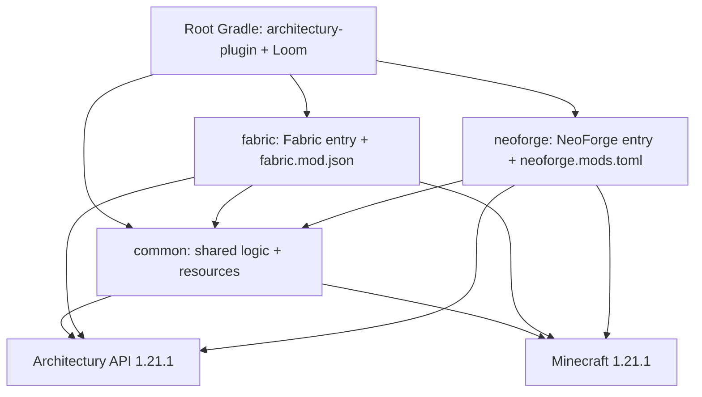
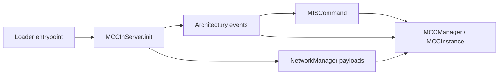

# Architectury Multi-loader (1.21.1)

Feature Name: architectury-multiloader
Updated: 2026-09-11

## Description

把当前单仓库 NeoForge MDK 重构为 Architectury Loom 多模块工程，在 Minecraft 1.21.1 上同时产出 NeoForge 与 Fabric 两套 jar。`common` 承载全部业务：MCC 进程管理、命令、会话、Cookie、网络 payload、客户端 GUI。`neoforge` / `fabric` 只保留加载器入口、元数据与 Loom 平台配置。跨加载器差异通过 Architectury API（Platform、EnvExecutor、LifecycleEvent、CommandRegistrationEvent、PlayerEvent、NetworkManager）消化。玩法语义与现有 NeoForge 实现保持一致。

## Architecture





Root 使用 `architectury-plugin` + `dev.architectury.loom`。三个子项目都走 Loom 官方 Mojang mappings，不再使用 `net.neoforged.moddev`。Fabric 与 NeoForge 各自 `architectury { platformSetupLoomIde(); fabric() / neoForge() }`，并通过 `common(project(path: ":common", configuration: "namedElements"))` 把 common 源码编进对应平台 jar。

产物路径：

- `neoforge/build/libs/mccinserver-1.0.0.jar`
- `fabric/build/libs/mccinserver-1.0.0.jar`

`archivesName` 两边都是 `mccinserver`，靠子项目目录区分。

## Components and Interfaces

### 1. Gradle layout

| Path | Role |
|------|------|
| `/settings.gradle` | include `common`, `fabric`, `neoforge` |
| `/build.gradle` | architectury-plugin、子项目公共 Java 21 / 资源替换 / Shadow 约定 |
| `/gradle.properties` | MC 1.21.1、NeoForge、Fabric Loader、Architectury API 版本、mod 元数据 |
| `/common/build.gradle` | loom + architectury common() |
| `/fabric/build.gradle` | loom fabric、shadow、依赖 common |
| `/neoforge/build.gradle` | loom neoForge、shadow、依赖 common |

`gradle.properties` 新增（名称可微调，语义固定）：

- `architectury_api_version`：1.21.1 线最新稳定版
- `fabric_loader_version`
- `fabric_loom` / Architectury Loom 版本由 plugins 声明

Fabric 模块只声明 Architectury API（`modImplementation` + `modApi`），`fabric.mod.json` 不写 `fabric-api` 依赖。Architectury API 的 Fabric 构件会带上它需要的 Fabric 能力。

### 2. Common initialization

现有 `MCCInServer` 去掉 `@Mod`、`IEventBus`、`NeoForge.EVENT_BUS`、`FMLEnvironment`、`PacketDistributor`。改为普通 bootstrap：

```text
MCCInServer.init()
  register payloads via MISNetwork.register()
  LifecycleEvent.SERVER_STARTED / SERVER_STOPPING
  CommandRegistrationEvent.EVENT -> MISCommand.register
  PlayerEvent.PLAYER_JOIN / PLAYER_QUIT
  EnvExecutor.runInEnv(Env.CLIENT, ClientAutoLoginHandler::register)
```

NeoForge 入口：`@Mod("mccinserver")` 构造里调用 `MCCInServer.init()`。

Fabric 入口：`ModInitializer.onInitialize()` 调用 `MCCInServer.init()`。客户端自动登录已由 common 里 `EnvExecutor` 注册，Fabric 不需要单独 `ClientModInitializer`，除非 Loom 拆分 client source set 后必须声明。

### 3. Platform substitutions

| Current NeoForge API | Architectury / Minecraft replacement |
|----------------------|--------------------------------------|
| `FMLPaths.CONFIGDIR` | `Platform.getConfigFolder()` |
| `FMLEnvironment.dist == Dist.CLIENT` | `EnvExecutor.runInEnv(Env.CLIENT, ...)` / `Platform.getEnvironment()` |
| `NeoForge.EVENT_BUS` + `@SubscribeEvent` | Architectury event `register` lambdas |
| `RegisterCommandsEvent` | `CommandRegistrationEvent.EVENT` |
| `ServerStartedEvent` / `ServerStoppingEvent` | `LifecycleEvent.SERVER_STARTED` / `SERVER_STOPPING` |
| `PlayerEvent.PlayerLoggedInEvent` / `LoggedOut` | `PlayerEvent.PLAYER_JOIN` / `PLAYER_QUIT` |
| `ClientPlayerNetworkEvent.*` + `ClientTickEvent.Pre` | `ClientPlayerEvent` + `ClientTickEvent.CLIENT_PRE` |
| `PacketDistributor.sendToPlayer/Server/All` | `NetworkManager.sendToPlayer/sendToServer/sendToPlayers` |
| `IPayloadContext` | `NetworkManager.PacketContext` |
| `RegisterPayloadHandlersEvent` / `PayloadRegistrar` | `NetworkManager.registerReceiver`（C2S/S2C + StreamCodec） |

`MCCInServer.sendToPlayer` / `sendToAllPlayers` 保留，内部改调 NetworkManager，并继续 `executeOnServerThread`，避免后台线程写 Connection。

### 4. Networking

Payload record、`TYPE`、`STREAM_CODEC` 留在 common。去掉 NeoForge `IPayloadContext`。handler 改为 Architectury `PacketContext`：

- C2S：`NetworkManager.registerReceiver(NetworkManager.c2s(), type, codec, handler)`
- S2C：仅在 client env 注册，避免 dedicated server 加载 `Screen` / `Minecraft`

发送方：

- 服务端 -> 玩家：`NetworkManager.sendToPlayer(player, payload)`
- 客户端 -> 服务端：`NetworkManager.sendToServer(payload)`
- 广播：`NetworkManager.sendToPlayers(server.getPlayerList().getPlayers(), payload)`

协议版本字符串保持 `"1"`。Architectury 1.21 若仍用 ResourceLocation 收发而非 CustomPacketPayload，则在 `MISNetwork` 做一层 encode/decode 适配，payload record 本身不变。

### 5. Shadow

Shadow 从根 NeoForge `build.gradle` 迁到两个 loader 模块，配置对齐现状：

- `toml4j:0.7.2`
- `commons-compress:1.26.0`
- `commons-codec:1.16.0`
- relocate 到 `com.xiaoze_qwq_.mis.shadow.*`
- `archiveClassifier = ''`，禁用普通 jar
- 排除 `META-INF/*.SF|DSA|RSA`，`mergeServiceFiles()`

common 对这三库用 `compileOnly` / `shadow` 可见性，由 loader 模块打包。

### 6. Resources

- `common/src/main/resources/assets/mccinserver/**`、`pack.mcmeta`
- `neoforge/src/main/resources/META-INF/neoforge.mods.toml`：依赖 `neoforge`、`minecraft`、`architectury`
- `fabric/src/main/resources/fabric.mod.json`：依赖 `minecraft`、`fabricloader`、`architectury`，不声明 `fabric-api`
- 资源占位符继续展开 `mod_id` / `mod_version` / `minecraft_version_range` 等

### 7. CI

`.github/workflows/build.yml` 保持 JDK 21，命令仍是 `./gradlew build`，产物覆盖两个 loader 模块。

## Data Models

无新持久化模型。现有文件路径全部改为 `Platform.getConfigFolder()`：

- `mis_config.toml`
- `mispassword`
- `mis_secret.key`
- `mis_auth.toml`

网络 payload 字段与现有 record 一致：`StatusRequestPacket`、`ImmersiveInputPacket`、`ImmersiveExitPacket`、`CookieAuthPacket`、`MCCOutputPacket`、`ImmersiveStatusPacket`、`OpenStatusScreenPacket`、`StatusDataPacket`、`InstanceRemovedPacket`、`CookieGrantPacket`、`CookieAuthResultPacket`。

## Correctness Properties

- 同一套 common 源码编进 Fabric 与 NeoForge，命令树、会话、MCC 生命周期一致。
- 配置目录解析与加载器无关，两边读写同一组文件名。
- 网络包 TYPE id 与 StreamCodec 字段顺序不变，跨加载器客户端/服务端可互通（两边都装本模组）。
- dedicated server 不加载 client GUI 类。
- 发包仍在服务端主线程执行。
- `mod_id` 两边都是 `mccinserver`。

## Error Handling

- Architectury / Loom 版本与 1.21.1 不匹配时，构建失败并在 README 写明属性名。
- 客户端注册 S2C 时用 Env 守卫；误在服务端加载 client handler 属于构建/拆分错误，用 source set 隔离。
- NetworkManager 发送失败沿用现有 `runSafely` 打 warn，不中断 MCC 后台进程。
- Fabric 环境缺少 Architectury API 时由加载器依赖检查拒绝启动。

## Test Strategy

- `./gradlew build` 必须同时打出 fabric 与 neoforge 两个 remap/shadow jar。
- 静态检查：common 源码中不再出现 `net.neoforged`、`net.fabricmc.fabric`（入口与 metadata 除外，它们在 loader 模块）。
- 手工：NeoForge 1.21.1 与 Fabric 1.21.1 各跑一次 `runClient` / `runServer`，验证 `/mis verify`、status GUI、immersive、cookie 自动登录。
- CI 编译即门禁；游戏内双加载器互通作为发布前手工项。

## References

[^1]: Architectury API Platform / NetworkManager / EnvExecutor / LifecycleEvent
[^2]: 当前工作区 `/src/main/java/com/xiaoze_qwq_/mis/MCCInServer.java`
[^3]: 当前工作区 `/src/main/java/com/xiaoze_qwq_/mis/network/MISNetwork.java`
[^4]: 当前工作区 `/build.gradle` Shadow 与 neoForge 配置
[^5]: 当前工作区 `/.monkeycode/specs/2026-09-11-architectury-multiloader/requirements.md`
