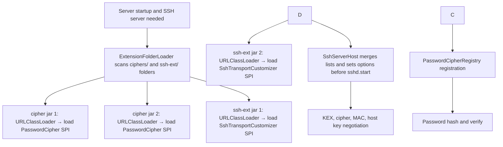

# Extension Folder Loading and SSH Transport Algorithm Customization

Feature Name: 2026-11-26-extension-folder
Updated: 2026-11-26

## Description

Replace the Mod‑jar‑in‑mods/ SPI channel for password hash algorithms with two dedicated folders under the server root: `ciphers/` (password hash algorithms) and `ssh-ext/` (SSH transport customizations). Add a new SPI interface `SshTransportCustomizer` that lets third‑party jars customize the embedded SSH handshake algorithms (KEX, cipher, MAC, signature, host key, key exchange factory). Extensions are pure Java jars that follow PM conventions, require no Mod metadata, and are loaded one‑per‑jar with the PM classloader as parent.

## Architecture



### 1. `ExtensionFolderLoader` (new class, `common`)

- Locates two folders directly under the server root: `ciphers/` and `ssh-ext/`; each folder’s existence is optional.
- Scans `*.jar` files under ciphers/ for the SPI file `META-INF/services/com.xiaoze_qwq_.processmanager.crypto.PasswordCipher`; scans `ssh-ext/` for `META-INF/services/com.xiaoze_qwq_.processmanager.ssh.SshTransportCustomizer`.
- Creates one `URLClassLoader` per jar, parent = `ExtensionFolderLoader.class.getClassLoader()` (PM’s runtime classloader).
- Parses the SPI file, instantiates the implementation class (zero‑argument constructor required), and registers it via the appropriate registry method.
- Isolation: each jar has its own classloader; first‑loaded jar wins if class names clash; failures are recorded per jar and reported in the startup log only.
- Each jar produces one `LoadedExtension` record: jar name, folder (`ciphers`/`ssh-ext`), status (`SUCCESS`/`SKIPPED`/`FAILED`), algorithm ids, transport customizer id, error reason.

### 2. `SshTransportCustomizer` (new SPI interface, `common`)

```java
public interface SshTransportCustomizer {
    /** Unique identifier of the customizer; returned by `id()` and used in logs. */
    String id();

    /** Key exchange algorithm names to insert at the front of the proposal list. */
    default List<String> kexAlgorithms() { return List.of(); }

    /** Session cipher algorithm names to insert at the front of the proposal list. */
    default List<String> cipherAlgorithms() { return List.of(); }

    /** Message authentication code algorithm names to insert at the front of the proposal list. */
    default List<String> macAlgorithms() { return List.of(); }

    /** Signature (public‑key) algorithm names to insert at the front of the proposal list. */
    default List<String> signatureAlgorithms() { return List.of(); }

    /** Host‑key specification; `null` means “keep the built‑in EC‑256 provider”. */
    default HostKeySpec hostKey() { return null; }

    /** Optional key‑exchange factory; `null` means “keep the built‑in factory”.
     *  When non‑null, the jar must relocate `org.apache.sshd` →
     *  `com.xiaoze_qwq_.processmanager.shadow.sshd` with sshd‑core in
     *  provided scope (same relocation as the main Mod) so that the factory
     *  links against PM’s runtime SSHD classes. */
    default KeyExchangeFactory keyExchangeFactory() { return null; }
}
```

Supporting record:

```java
public record HostKeySpec(
        String algorithm,       // e.g. "EC", "RSA", "Ed25519"
        int keySize,            // e.g. 256, 2048
        String fileName,        // relative to PM config folder; must include algorithm name
        byte[] keyBytes         // optional pre‑serialized key; if null, generate & persist
) {}
```

- `hostKey()` returns a `HostKeySpec`; the algorithm name drives `SimpleGeneratorHostKeyProvider` or a custom provider. The file name inside the spec must not collide with the existing `pm_ssh_hostkey_ec.ser`.
- `keyExchangeFactory()` returns an `org.apache.sshd.server.kex.KeyExchangeFactory`. Jars that override this method **must** apply the same relocation as the main Mod (`org.apache.sshd` → `com.xiaoze_qwq_.processmanager.shadow.sshd`) and declare sshd‑core as provided‑scope only; otherwise the factory cannot link against PM’s runtime classes.

### 3. `PasswordCipherRegistry` refactor

- Replace the `ServiceLoader.load(PasswordCipher.class, classLoader)` classpath scan in `loadExternal()` with the `ExtensionFolderLoader`‑driven registration.
- Keep the `register/detect/verify/matches` core logic untouched; built‑in ciphers (`bcrypt`, `pbkdf2‑sha512`) stay registered in code regardless of extensions.
- Decision point (pending user confirmation): the legacy classpath channel may be removed entirely (`mods/`/SPI) as per the confirmed “folder‑only” option.

### 4. `SshServerHost.doStart()` additions

- After `sshd = SshServer.setUpDefaultServer();` and the existing property settings (`SERVER_IDENTIFICATION`, `MAX_AUTH_REQUESTS`, …) but **before** `sshd.start()`:
  1. Collect all `LoadedExtension` records from `ExtensionFolderLoader`.
  2. **Transport algorithm merge** (see §5):
     - Build merged lists: custom names first (first non‑null value per item in jar‑name lexicographic order), then the built‑in sshd 2.13.2 default names.
     - If a custom list is non‑empty, set it on the sshd instance via the corresponding `CoreModuleProperties.*` property (`KEX_ALGORITHMS`, `CIPHER_ALGORITHMS`, `MAC_ALGORITHMS`, `SIGN_ALGORITHMS`). Only set properties for lists that are non‑empty after merging; empty lists leave the built‑in defaults in place.
  3. **Host key** (`HostKeySpec`):
     - If any customizer returns a non‑null `HostKeySpec`, the first one wins; PM builds a `SimpleGeneratorHostKeyProvider` from the spec (algorithm → `setAlgorithm("EC")` / `setKeySize` / file name to load from `Platform.getConfigFolder()` / optional `keyBytes`). The key file name must include the algorithm identifier to avoid collision with the default `pm_ssh_hostkey_ec.ser`.
  4. **Key exchange factory**:
     - If any customizer returns a non‑null `KeyExchangeFactory`, set it via `sshd.setKeyExchangeFactory(...)` before `sshd.start()`. Jars providing this are reminded to apply the relocation.
  5. After all customizations, proceed with the existing `sshd.start();`.

### 5. Algorithm‑list merge order (formal)

When customizers provide values for the same algorithm category:

1. Sort customizers by jar file name lexicographically.
2. The first customizer’s value for that category wins; later values are ignored and logged at WARN.
3. If the winning value is empty/`null`, fall through to the built‑in sshd 2.13.2 defaults.
4. The final merged list (custom-first + defaults) is logged as the “effective algorithm set”.

### 6. Command layer

- New console command `/pm ext list`:
  - Lists each loaded extension jar (folder, name, load status `SUCCESS`/`SKIPPED`/`FAILED`, provided algorithm ids for ciphers, customizer id for ssh‑ext).
  - Outputs the effective transport algorithm lists currently in effect: KEX / cipher / MAC / signature names, host key algorithm, and whether a custom key exchange factory is installed.
- Existing `/pm hash list` continues to show registered password hash algorithms; now the list includes both built‑in and any external ciphers loaded from `ciphers/`.

### 7. Extension jar packaging

- Extension jars are plain Java archives placed in `ciphers/` or `ssh-ext/` under the server root; **no** `fabric.mod.json` / `META-INF/neoforge.mods.toml` metadata is needed.
- Packaging red lines (same as the existing `skills/crypto-module/SKILL.md`):
  - Must not bundle PM interface classes, `org.apache.sshd`, `com.sun.jna`, `net.i2p.crypto.eddsa`, or `org.jetbrains.pty4j` classes.
  - Where an implementation references PM extension interfaces at compile time, those dependencies must be declared in `provided` scope only, and the classes must not appear in the runtime jar.
  - **SSH‑ext jars that provide a `keyExchangeFactory()`** must also apply the identical relocation as the main Mod: `org.apache.sshd` → `com.xiaoze_qwq_.processmanager.shadow.sshd`, with sshd‑core declared as provided‑scope only. This ensures the factory links against PM’s runtime relocated SSHD classes.
- For development, the extension jar can be built with the same Gradle shadow plugin used by the main mod; in the run environment (no local JDK per project convention) the jar is simply dropped into the appropriate folder.

## Data Model

`LoadedExtension` (in‑memory only, produced by `ExtensionFolderLoader`):

| Field            | Type                              | Meaning                                                    |
|------------------|-----------------------------------|----------------------------------------------------------|
| `jarName`        | `String`                          | jar file name only (no path)                             |
| `folder`         | `String`                          | `"ciphers"` or `"ssh-ext"`                               |
| `status`         | `Enum` (`SUCCESS`/`SKIPPED`/`FAILED`) | load result                                              |
| `error`          | `String` \|\| `null`              | failure reason, or `null` if successful                  |
| `cipherIds`      | `List<String>`                    | registered password hash algorithm ids (populated only for `ciphers` folder) |
| `transportId`    | `String` \|\| `null`              | the customizer `id()`, or `null` if no customizer loaded  |

Effective transport algorithm set (runtime computed, not stored persistently):

| Property                | Source                                    |
|-------------------------|-------------------------------------------|
| `kexAlgorithms`        | custom-first merged list from `SshTransportCustomizer` |
| `cipherAlgorithms`     | same                                      |
| `macAlgorithms`        | same                                      |
| `signatureAlgorithms`  | same                                      |
| `hostKeyAlgorithm`     | from first non‑null `HostKeySpec.hostKey.algorithm` |
| `keyExchangeFactory`   | first non‑null `SshTransportCustomizer.keyExchangeFactory()` |

## Correctness Properties

1. **Equivalence with no extensions** — When neither `ciphers/` nor `ssh-ext/` exists, behavior is byte‑for‑byte identical to the current release: EC P‑256 host key, sshd 2.13.2 built‑in algorithm lists, bcrypt/PBKDF2 ciphers.
2. **Built‑in ciphers stay registered** — `bcrypt` and `pbkdf2‑sha512` are always available via `/pm hash set` regardless of extension loading outcomes.
3. **Failure isolation** — A failed or corrupt extension jar never blocks server startup or SSH service startup; only that jar is skipped.
4. **Old password hashes persist** — Prefix‑based `detect()` verifies old hashes after the algorithm set changes; old passwords remain usable.
5. **Effective algorithm list is resolvable** — Unresolvable names are dropped with a WARN; sshd ignores unknown names during negotiation.
6. **No duplicate ids** — Duplicate `PasswordCipher` ids across jars: first registration wins, later ones warn and are ignored. Same rule applies to `SshTransportCustomizer` `id()` (though the default `id()` returns the class name; custom implementations should return a stable string).

## Error Handling

| Scenario                                              | Handling                                                 |
|-------------------------------------------------------|----------------------------------------------------------|
| `ciphers/` or `ssh-ext/` folder missing               | Silently skip that folder; continue with built‑in only    |
| Corrupt jar / IO error while reading jar               | Warn with jar name, skip that jar                        |
| SPI file declares a class that cannot be instantiated  | Warn with jar name + class name, skip that implementation |
| Duplicate algorithm `id` across ciphers jars          | First registration wins; later ones WARN and ignored      |
| Duplicate customizer `id` across ssh-ext jars         | First wins; later WARN and ignored                        |
| Unresolvable algorithm name in sshd                   | Drop that name, WARN, keep remaining merged list           |
| Extension jar’s constructor throws                     | WARN, skip that jar entirely                             |
| Two customizers provide values for the same item        | First in jar‑name lexicographic order wins; later WARN   |

## Test Strategy

- **Unit tests** (`common/src/test/java`, JUnit 5, run by the CI `test-common` job):
  - Build a temporary extension folder and a minimal jar with the correct `META‑INF/services/…` SPI file; verify scan, registration, and failure isolation.
  - Assert merge order (first‑wins, lexicographic fallback) and that `LoadedExtension` statuses are as expected.
  - Smoke‑test `/pm ext list` output after building a sample jar pair.
- **CI**: GitHub Actions builds fat/thin variants and runs `:common:test`; per project convention no local JDK is used.
- **Manual verification list** (after a build): drop a sample cipher jar into `ciphers/` and a sample ssh‑ext jar into `ssh-ext/`, start the server, check the startup log, `/pm hash list`, `/pm hash set <id>`, `/pm ext list`, and SSH login with old passwords and default algorithm lists when no extensions are present.

## Packaging and Build Changes

- **`gradle.properties`**: bump `mod_version` to `1.0.14` (per project “每次更新必须提升版本” convention).
- **`common/build.gradle`**: keep the existing `test` configuration; no source‑set changes required for the core refactor (new classes are added under `common/src/main/java/com/xiaoze_qwq_/processmanager/`).
- **Shadow relocation** for `ssh‑ext` jars: see SKILL.md update below; the main mod’s shadow configuration already relocates `org.apache.sshd`; ssh‑ext jars that need it must use the same relocation pattern.

## SKILL.md Update

Update `skills/crypto-module/SKILL.md` to reflect the new folder‑based extension mechanism:

- The skill now documents that a cipher module jar is dropped into `ciphers/` under the server root rather than placed into `mods/`. The development steps (write `PasswordCipher`, declare SPI, build jar, drop it) remain largely the same, but the “installation” step changes to `cp build/libs/<jar>.jar <server‑root>/ciphers/`.
- A new section describes how to create an SSH transport customization jar (`SshTransportCustomizer`) and the relocation requirement for `keyExchangeFactory`.
- The existing “red lines” (no `org.apache.sshd`, `com.sun.jna`, etc.) are unchanged; the additional “relocation‑required” note for ssh‑ext jars is added.

## References

[^1]: (skills/crypto-module/SKILL.md) – Existing password cipher module specification  
[^2]: (common/src/main/java/com/xianoze_qwq_/processmanager/crypto/PasswordCipherRegistry.java) – Current SPI registry and classpath loading  
[^3]: (common/src/main/java/com/xiaoze_qwq_/processmanager/ssh/SshServerHost.java) – Embedded SSH server startup sequence  
[^4]: (MEMORY.md) – Project constraints: CI verification, version bump, eddsa/sshd packaging rules